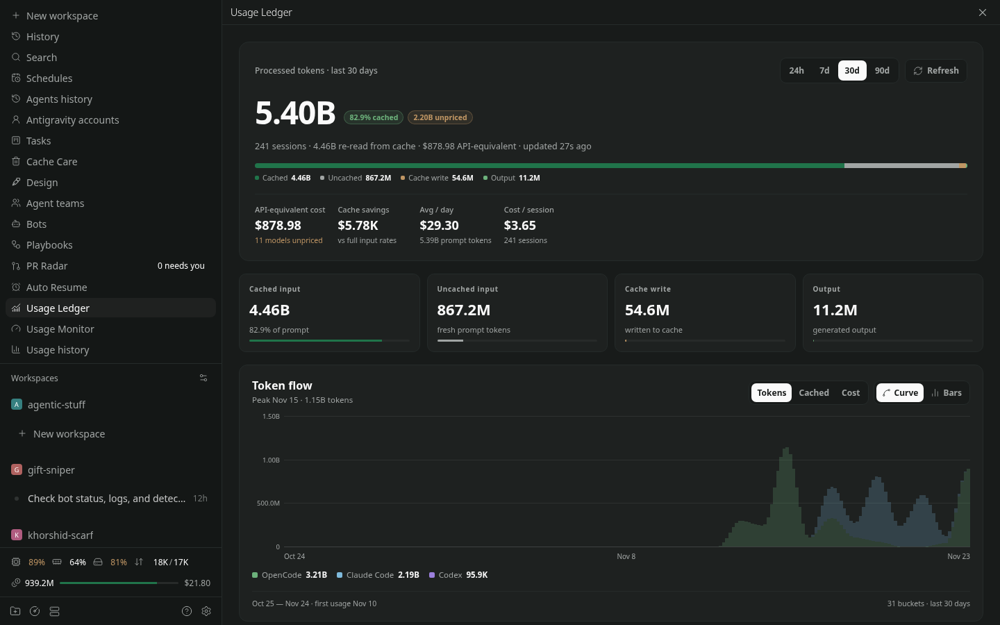
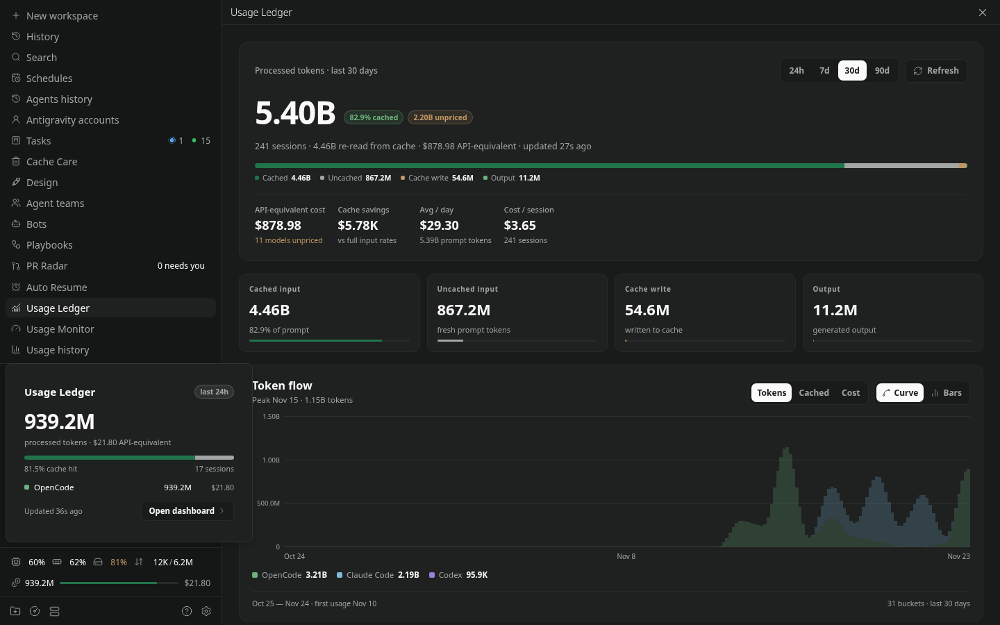
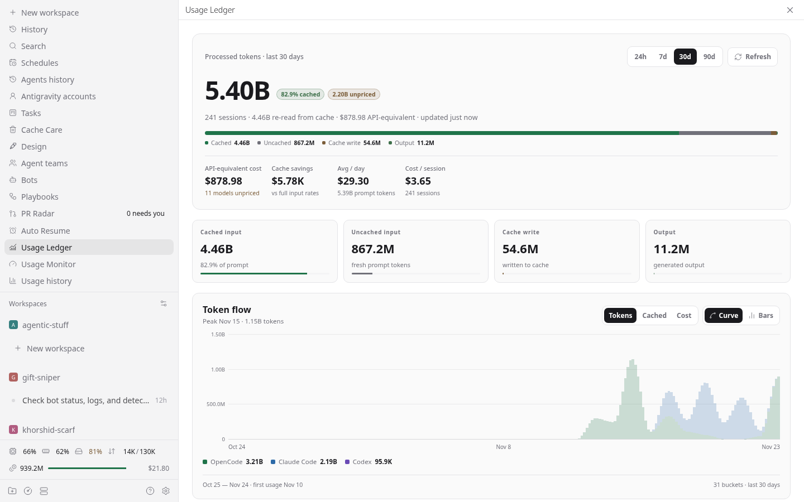

# Usage Ledger

[](https://github.com/sudosz/paseo-usage-ledger/actions/workflows/ci.yml)

Paseo agents spend tokens across OpenCode, Claude Code, Codex, and Bifrost lanes. Usage Ledger reads the logs those tools already write and puts the numbers in one place: volume, cache behavior, and what the same traffic would cost at published API rates.



Open it from **Usage Ledger** in the sidebar, or from the footer row. The footer keeps the last 24 hours in view: processed tokens, a cache-hit meter, and estimated cost. Click it for the harness split and a shortcut to the dashboard.



<details>
<summary>Light theme</summary>



</details>

## Install

```bash
paseo plugin install git:https://github.com/sudosz/paseo-usage-ledger.git
```

The plugin starts with the daemon. Update it with:

```bash
paseo plugin update usage-ledger
```

## What it shows

- 24h, 7d, 30d, and 90d ranges.
- Processed tokens, cached input, uncached input, cache write, and output.
- Cache hit rate and gross cache savings at API rates.
- A stacked harness chart with token, cached, and cost metrics; curve or bars.
- Per-harness sessions, cache rate, spend, and unpriced volume.
- Per-model tokens, cache rate, share, blended cost per million tokens, and the full token split on expand.
- **Unpriced** for any model without a reported cost or a bundled rate.

The chart names its peak bucket. When a selected range begins before the first recorded usage, the footer says where the data starts instead of leaving an unexplained gap.

## Sources

| Source | Read | Attribution |
| --- | --- | --- |
| OpenCode | `~/.local/share/opencode/opencode.db`, `session` table | Model, provider, reported cost, token counters |
| Claude Code | `~/.claude/projects/**/*.jsonl` | Assistant usage records, cache creation/read, session id |
| Codex | `~/.codex/sessions/**/*.jsonl` | `token_usage_record` events, thread model/provider |
| Bifrost | `~/.paseo/usage/bifrost.json` | Optional aggregate lane snapshot from the host |

Bifrost's config database is never mounted into the Paseo container. A host exporter can write session/lane totals to the JSON snapshot:

```bash
sudo install -m 755 tools/bifrost-usage-export.py /usr/local/bin/
sudo crontab -e   # */5 * * * * /usr/local/bin/bifrost-usage-export.py
```

## Cost model

Reported OpenCode costs win. Claude and Codex costs are estimated from the bundled rate table. A model with neither stays **Unpriced**, is excluded from cost, and is never drawn as free.

`processed = uncached input + cache read + cache write + output`

`cache savings = cache read × (input rate − cache read rate)`

Savings are gross, so they can exceed total spend. These are API-equivalent estimates, not a subscription bill. The model drilldown divides estimated cost by processed tokens; it is not an invoice line.

## Performance

Usage is scanned on demand, not per token.

- The screen scans on open, refresh, or focus. Summaries cache for 60 seconds with in-flight deduplication.
- A finished agent turn invalidates the server cache instead of triggering a background poll.
- The footer checks the cached 24h rollup every two minutes.
- JSONL files are parsed once per mtime and size, then kept in memory.
- OpenCode reads the `session` table, not the full multi-gigabyte database.
- SQLite handles are read-only and closed after each query.
- No `ccusage` binary and no shell process per refresh.

This is not a zero-allocation design. Parsing JSON and building maps allocate; the goal is bounded work and no per-token polling. The benchmark asserts the current floors:

| Check | Floor | Latest local run |
| --- | --- | --- |
| Claude line parse | 50k ops/s | 918k ops/s |
| Codex line parse | 50k ops/s | 939k ops/s |
| Aggregate 200k events | 150k ops/s | 596k ops/s |
| Summarize 200k events | under 50 ms | 0.4 ms |
| Heap delta, 200k events | under 60 MiB | 23 MiB |

Run it yourself with `npm run bench -- --assert`. The benchmark is part of CI, so a large regression fails the build rather than living in a comment.

## Development

```bash
npm ci
npm run lint        # oxlint
npm run typecheck   # strict TypeScript
npm test            # parsers, aggregation, pricing, formatting, palette, chart scale
npm run bench -- --assert
```

CI runs the same four checks plus `npm pack --dry-run` on Node 22. It cancels superseded runs and has a ten-minute timeout.

```
client/     screen, footer, chart, palette, formatting
server/     parsers, aggregation, sources, caches
shared/     RPC contract
tests/      pure unit tests
bench/      asserted performance floors
tools/      host-side Bifrost exporter
```

## Limits

- A session is counted in the window of its updated timestamp. Sessions that cross a range boundary are not split.
- Bifrost retention is short, so lane attribution is best-effort.
- Pricing lives in `server/pricing.ts`; add a rate there when a model is missing.
- The dashboard estimates list-price cost. It does not read subscription balances or provider invoices.

MIT.
